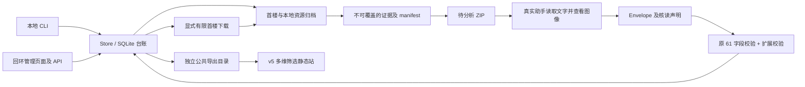

# 架构与数据协议

## 来源与复用决策

参考项目为项目所有者提供的 `forumcrawl`；来源文件身份通过 `provenance.json` 中的 SHA-256 保留。

该项目的持久队列、不可变证据、有限停止、URL 验证与核验设计被用于本项目。`vendor/forumcrawl/site_profiles.py` 是保留来源的参考快照，不作为新采集器执行；原无限 controller 不加载、不运行。原项目缺少 NodeSeek 首楼原生提取与图片实际归档，因此新增窄范围 NodeSeek 适配器，采用原下载技能的明确首楼边界和报告域限制。

`vps_pipeline/vendor/vps-review-analyze/` 保留原技能、61 字段目录和校验器，并随 Python 包声明为数据文件。程序直接复用其校验/归一化函数，在外层添加 manifest 哈希绑定、观察明细、核读声明和版本台账。来源文件哈希见 `provenance.json`。参考根目录未发现单独许可证，不生成臆造的许可授权，见 `NOTICE`。

## 模块



| 文件 | 职责 |
|---|---|
| `vps_pipeline/cli.py` | 有限操作入口，显式网络开关 |
| `vps_pipeline/store.py` | SQLite 事务、租约、去重、版本及导出 |
| `vps_pipeline/archive.py` | 严格首楼解析、本地资源导入、路径/类型/哈希校验 |
| `vps_pipeline/network.py` | 仅规范 NodeSeek 首页面的有界下载与访问限制停止 |
| `vps_pipeline/analysis.py` | 待分析包、原协议复用、证据绑定及扩展校验 |
| `vps_pipeline/server.py` | 回环服务、会话 token、Host/Origin 和请求体约束 |

没有调度器或常驻采集线程，也没有模型客户端。服务启动只提供管理页面/API。

## 状态、幂等和恢复

正常链路为 `queued → archiving → awaiting_analysis → validating → accepted`。`partial` 是证据归档的完整度，不是任务状态；缺失资源仍可进入待分析，缺失事实须保持未知。

| 状态 | 含义及下一步 |
|---|---|
| `queued` | 已入队，等待离线导入或显式网络采集 |
| `archiving` | 持有租约的有限归档操作 |
| `awaiting_analysis` | 证据已存，等待真实助手核读/提交 |
| `validating` | 持有租约的提交校验操作 |
| `accepted` | 至少一次合规分析已入库；仍可提交新版本 |
| `blocked` | 访问或安全限制，停止本批网络采集；不自动重试 |
| `failed` | 归档/传输等操作失败，记录原因后可人工恢复 |
| `cancelled` | 未完成任务已取消，证据和事件保留，可人工恢复 |

规范 URL 在数据库中唯一，同 URL 入队返回原任务。分析提交以内容摘要去重；接受的新内容分配递增版本，保留原 envelope、标准化结果、校验记录及事件。

活动操作使用独立随机租约 token 和 600 秒到期时间；提交结果前必须仍持有相同 token。`recover` 只处理过期的 `archiving`/`validating`，有已登记归档时回到 `awaiting_analysis`，若当前快照已有接受版本则恢复 `accepted`，无归档则回到 `queued`。其作用是恢复台账，不会终止原进程；操作人员应先确认中断进程已停止。未过期操作不被抢占。取消也不会杀死活动进程。访问受限任务持久保留 `network_blocked` 标记，取消、失败、恢复不能重新授权网络请求。

已有证据文件使用排他写入；同名内容必须一致。导入互斥使用操作系统锁，进程退出会释放锁，保留的 `.import.lock` 文件不表示仍被锁定，不能删除它来解锁。每次任务导入在独立快照目录中构建并校验归档，完全相同的证据复用原快照；不同内容指向新快照，保留旧快照和分析。因而重复 `ingest` 可以补齐资源或接纳首楼变化，而不改写旧证据。底层适配器对同一快照中的变化仍会报冲突。分析版本保存各自的归档路径和哈希，公共导出取版本绑定的证据，当前新快照不能误用旧分析提交。改变 manifest 后需导出新的分析包。

## 私有数据布局

```text
var/
  pipeline.sqlite3        # jobs、events、analyses；运行时可能有 WAL/SHM
  archives/<job_id>/snapshot-<token>/assets/<post_id>/
    manifest.json        # vps-archive/1
    first_post_*.html
    first_post_*.txt
    image-*.*
    report_*.*
  tmp/                   # 有限网络操作临时目录
  api-tmp/               # API 上传内容的临时文件
```

文件名按内容摘要生成，以实际 manifest 为准。完整页面仅用作输入；归档只保存首楼派生片段、文字及允许资源。输入页原字节 SHA256 和字节数保存在 `capture_metadata`，提取方式为 `saved_html_first_post_extraction`，并明确 `source_document_stored=false`、`visual_review=not_performed`。网络获取另在 `http_response_received` 事件保留允许字段的响应信息。未把回复、侧栏或原页面脚本渲染为管理页面。

## 分析协议与证据责任

`vps-analysis-work-package/1` 包含 `vps-archive/1` 原始证据、原技能、目录、未完成草稿。`vps-analysis-envelope/1` 通过 manifest **原始字节** 的 SHA256 绑定该包；重新序列化 manifest 也会改变绑定。

`analysis` 沿用原 `vps-analysis/1`，扩展信息放在独立 `observations` 与 `review_log`，避免破坏原 61 字段口径。每个观察保存套餐/实测/背景/现官网/推断类别，原始值和单位、状态、证据、注释；基准版本、网络 IP 族、方向、协议、运营商可明确为未知。原始提交与校验后结果分别保留，便于核对程序重算的时段或延迟统计。

导入验证包括结构、归档哈希、证据文件、文本引用、原字段类型、受支持的派生计算、观察元数据、核读日志与已声明文件的一致性。所有图像要求核读记录；`partial` 覆盖必须写明具体问题。冲突至少有两个不同引用，未知不补默认值。

程序不能确认提交者真的看过图像，也不能证明 OCR 或事实正确。`reviewer` 只是声明文本，不是验证身份；没有签名服务。`ai_invoked=false` 和 `review_attestation_verified=false` 会一直保留在校验限制中。草稿直接提交应被拒绝，不能为通过校验自动补写已核读。

## 输入与网络边界

- 任务 URL 仅接受 `https://www.nodeseek.com/post-<正整数>-1`，不接受任意目标、凭据、查询参数、其他页码或内网地址。
- 网络下载限制目标、DNS 返回地址、总时限和大小；不加载代理/cookie/登录凭据，不执行页面脚本，不自动跟随重定向。限制响应或传输失败停止本批次；没有无限重试。
- 本地导入只允许首楼引用图片与指定报告域；资源必须位于 HTML 目录内，校验安全相对路径、文件类型和 SHA256。未引用映射不读取。
- 管理服务只接受 `127.0.0.1`/`::1`，每个进程生成随机 token；API 要求 `X-VPS-Token`，约束 Host/Origin 与请求大小。管理端不暴露通用文件读写、shell 或网络执行接口。

这仍然是本机受信操作人员使用的工具，文件系统账户需限制私有目录权限；不应把管理服务反向代理到公网。

## 公共投影与 v5 接口

0.2.0已从保留的v5源码整合原筛选网页。原120篇/128对象/22份复核的公开JSON保持原样；运行时的已接受结果和历史关联通过catalog_feed与catalog_adapter投影。

/catalog/只服务固定白名单资源；catalog-snapshot.json原子提供五个兼容公开数据文件，不能读取SQLite、归档路径或原始证据。管理API继续使用token、Host/Origin防护，不提供任意路径读取。

export-public与export-v5是同一安全网页出口，生成独立静态筛选站，不含原文、原图、原始引文、作者、核读者、IP、私有路径或token。新结果必须有明确对象映射；原v5历史复核作为reviewHistory保留，其他中间接受版本仍在私有SQLite。未知/冲突、测量版本、原单位及网络维度不混合。

早期带原证据的vps-public-export/1出口仅作为内部兼容方法保留，CLI明确改名export-evidence，标记visibility=private_evidence和publish_safe=false。它不是网站发布数据，包含原文和图像，不能发布。详情见WORKFLOW-INTEGRATION.md。
